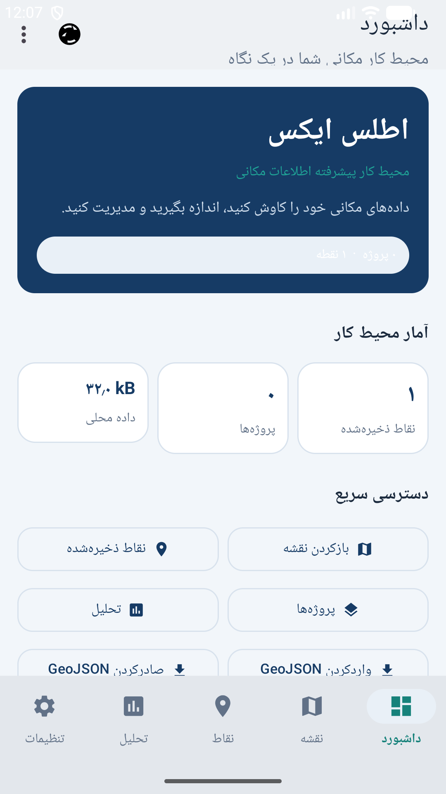
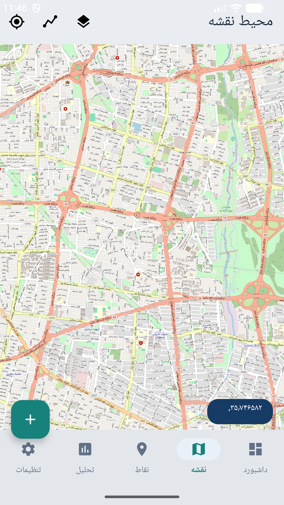
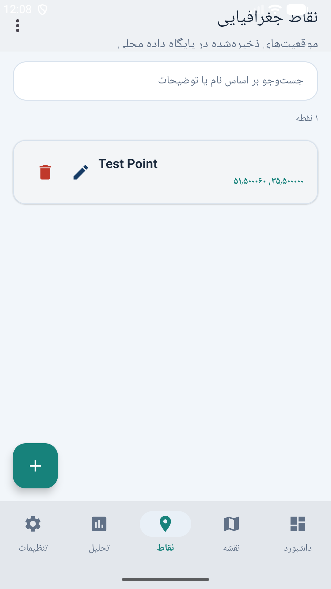
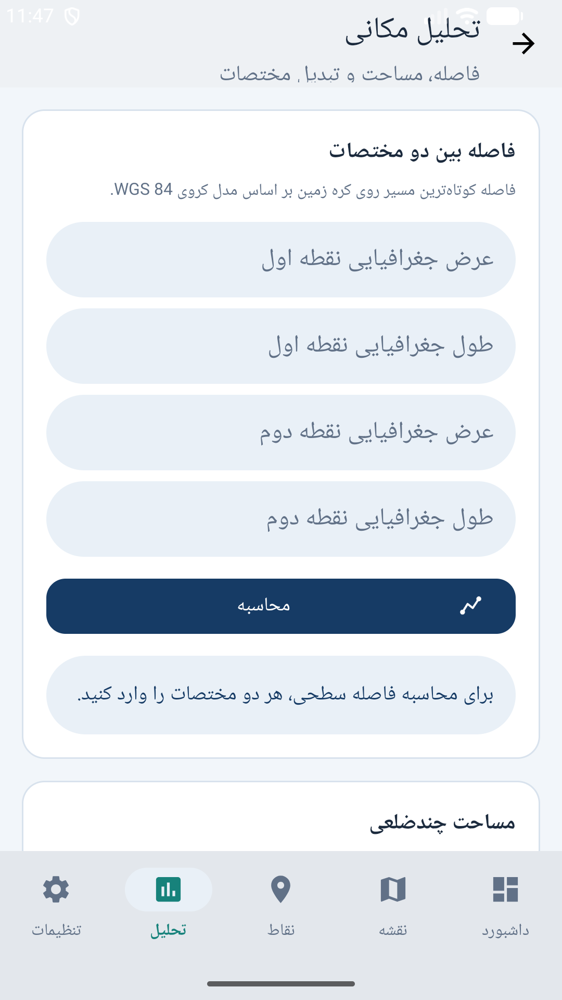
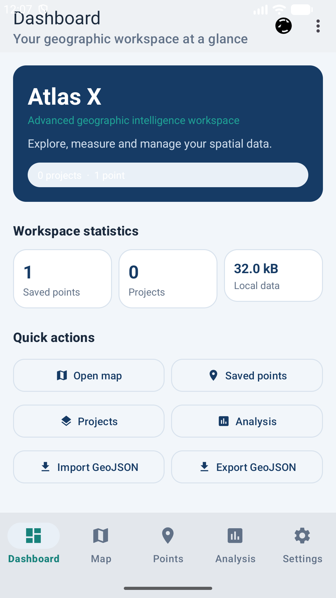
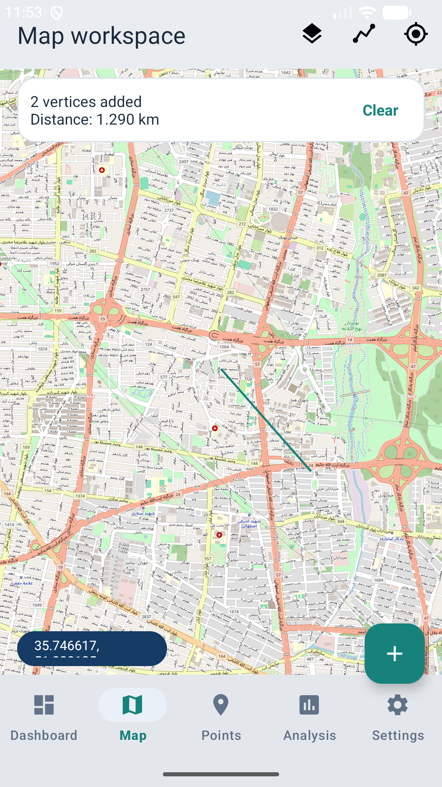

# Atlas X — Professional GIS Workspace for Android

Atlas X is a production-quality, bilingual (English / Persian, full RTL) geographic
information system application for Android. It lets users collect, organise, explore,
measure and interchange geographic points on an OpenStreetMap-based map, with everything
stored locally on the device.

| | |
|---|---|
| **Package** | `com.atlasx.gis` |
| **Language** | Java 11 (no Kotlin) |
| **Min / Target SDK** | 24 (Android 7.0) / 37 (Android 17) |
| **Build** | Gradle 9.5.0, Android Gradle Plugin 9.3.3 |
| **Map engine** | osmdroid 6.1.20 |
| **UI kit** | Material Components 1.14.0 |
| **Storage** | SQLite (framework) + SharedPreferences |
| **Version** | 2.0 (versionCode 2) |

## Screens

1. **Dashboard** (`MainActivity`) — workspace summary, live database statistics,
   quick actions (open map, points, projects, analysis, import/export GeoJSON),
   recent points, language switch.
2. **Map** (`ui/MapActivity`) — interactive OpenStreetMap / CARTO tiles, tap to read
   coordinates, long-press to add a point, saved-point markers, distance/area
   measurement tools, my-location with runtime permission, offline banner, and a
   pick-a-location mode used by the point editor.
3. **Points** (`ui/PointsActivity`) — searchable list of saved points (RecyclerView),
   create / edit / delete, GeoJSON import & export (Storage Access Framework),
   share as plain text.
4. **Point editor** (`ui/PointEditorActivity`) — name, latitude/longitude (decimal or
   DMS input), description, optional project assignment, "pick on map" helper.
5. **Projects** (`ui/ProjectsActivity`) — create, rename and delete projects; each
   project groups points by id.
6. **Analysis** (`ui/AnalysisActivity`) — decimal ↔ DMS coordinate converter,
   distance between two points, path length, polygon area and perimeter.
7. **Settings** (`ui/SettingsActivity`) — language (English/Persian), coordinate
   format (decimal/DMS), units (metric/imperial), tile source, map cache size,
   saved-view reset, storage diagnostics, about.

## Screenshots

Captured on an Android 17 (API 37) emulator — see [`docs/screenshots/`](docs/screenshots/):

| | |
|---|---|
|  |  |
| **Dashboard (Persian / RTL)** | **Map with tiles (Persian)** |
|  |  |
| **Points list** | **Analysis tools** |
|  |  |
| **Dashboard (English)** | **Measurement mode** |

## Building and running

Requirements: JDK 17+ (tested with JDK 24), Android SDK with platform `android-37.0`,
build-tools 37.x, an emulator or device on API 24+.

```bash
./gradlew assembleDebug            # build the debug APK
./gradlew test                     # run the 30 unit tests
./gradlew lintDebug                # static analysis (0 errors, 4 documented warnings)
adb install -r app/build/outputs/apk/debug/app-debug.apk
```

Or simply open the project in Android Studio and press **Run**.

## Documentation

| Document | Contents |
|---|---|
| [docs/ARCHITECTURE.md](docs/ARCHITECTURE.md) | Layers, packages, navigation, data flow, threading, localisation |
| [docs/COURSE_COVERAGE.md](docs/COURSE_COVERAGE.md) | Mapping of all 32 course units to the implementation |
| [docs/TEST_REPORT.md](docs/TEST_REPORT.md) | Unit tests, lint results, on-device smoke tests, bug log |
| [docs/USER_GUIDE.md](docs/USER_GUIDE.md) | End-user manual for every screen |
| [docs/TECHNICAL_DECISIONS.md](docs/TECHNICAL_DECISIONS.md) | ADR-style record of design choices and trade-offs |

## Project layout

```
app/src/main/java/com/atlasx/gis/
├── AtlasXApp.java            # Application: locale + tile cache setup
├── MainActivity.java         # Dashboard
├── data/
│   ├── AtlasDatabase.java    # SQLiteOpenHelper (schema v3) + migrations
│   ├── SettingsRepository.java  # SharedPreferences facade
│   └── model/                # SavedPoint, Project
├── geo/                      # Pure logic, fully unit-tested
│   ├── GeoMath.java          # haversine, path length, polygon area/perimeter
│   ├── GeoFormat.java        # number/coordinate formatting, DMS parse/format
│   └── GeoJson.java          # FeatureCollection read/write
├── ui/                       # Activities, adapters, shared bottom nav
└── util/                     # executors, locale, notifications, SAF helpers
```

## Privacy

Atlas X has no account system, no analytics and no network traffic other than
downloading map tiles. All points, projects and preferences stay in the app's own
local storage on the device.
